## 🧑‍💻 Sobre mí

- 🏫 Trabajo en el **Centro de Cómputo** del Instituto Tecnológico de San Luis Potosí (TecNM).
- 👨‍🏫 Enseño desarrollo web.
- 🌱 Actualmente construyendo nuevos proyectos y fortaleciendo mi portafolio.

<b>🇬🇧 About me (English)</b>

- 🏫 I work at the **Computer Center (Centro de Cómputo)** of Instituto Tecnológico de San Luis Potosí (TecNM).
- 👨‍🏫 I teach web development.
- 🌱 Currently building new projects and growing my portfolio.

## 🧰 Tecnologías · Tech stack

  
  
  
  
  
  
  
  
  
  

## 🚀 Proyectos publicados · Published projects

| Proyecto · Project       | Descripción · Description                                                                                                                                                                        | Stack                   | Enlaces · Links                                                                                                                          |
| ------------------------ | ------------------------------------------------------------------------------------------------------------------------------------------------------------------------------------------------ | ----------------------- | ---------------------------------------------------------------------------------------------------------------------------------------- |
| 🧠 **Memorama BioShock** | Juego de memoria en pixel art con cronómetro, récord guardado en el navegador y fondo animado.   _Pixel art memory game with a timer, a browser-saved high score and an animated background._ | HTML · CSS · JavaScript | [🎮 Jugar · Play](https://hector-dsg.github.io/memorama-bioshock/) · [💻 Código · Code](https://github.com/Hector-DSG/memorama-bioshock) |

## 🚧 Proyectos en desarrollo · Work in progress

| Proyecto · Project           | Descripción · Description                                                                                                          | Stack                         |
| ---------------------------- | ---------------------------------------------------------------------------------------------------------------------------------- | ----------------------------- |
| 🗺️ **Campus Navigation App** | App móvil con mapa georreferenciado para moverse por el campus.   _Mobile app with a georeferenced map to navigate the campus._ | React Native · Expo           |
| 🎮 **Gamification Demo**     | Avatares 3D y gamificación para un sistema de gestión escolar.   _3D avatars and gamification for a school management system._  | Laravel · Filament · Three.js |

> Pronto agregaré enlaces a los repositorios. · _Repository links coming soon._

## 🎯 Ahora mismo · Right now

- 🔨 **Construyendo · Building:** una app de navegación para el campus y una demo de gamificación con avatares 3D.
- 📚 **Aprendiendo · Learning:** JavaScript puro (DOM, eventos y `localStorage`) haciendo mini juegos para mi portafolio · _vanilla JavaScript (DOM, events and `localStorage`) by building small games for my portfolio._
- 👨‍🏫 **Enseñando · Teaching:** fundamentos de desarrollo web (HTML, CSS, JavaScript).

## 💬 Pregúntame sobre · Ask me about

`Desarrollo web` · `Laravel` · `Bases de datos MySQL` · `Administración de sistemas` · `Enseñanza de programación`

<!-- Reactiva las estadísticas cuando tengas más actividad / Re-enable stats once you have more activity:

## 📊 GitHub

  
  

-->

## 📫 Contacto · Contact

  
  <!-- Agrega tus enlaces / Add your links:
  
  
  -->

